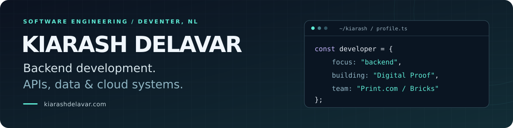

**Software Engineering Student · Backend Developer**

[Print.com](https://www.print.com/) intern · Saxion University of Applied Sciences · Deventer, Netherlands

[Experience](#currently-building) · [Projects](#selected-projects) · [Tech](#tech-i-work-with) · [Languages](#languages) · [Opportunities](#lets-talk)

---

At Print.com, I'm working on the backend between a customer reviewing a print proof and an order moving into production. That's the kind of problem I enjoy: connecting **APIs, data, and business rules** to make a real workflow work.

I'm a third-year Software Engineering student at Saxion, with expected graduation in **July 2028**. My projects have taken me from print workflows to cycling analysis, robotics, and energy simulation. Across them, I like understanding both the system and the people who will use it.

## Currently building

### Print.com · Digital Proof
**Software Engineering Intern · Bricks backend team**

Developing the workflow for reviewing and approving proof files before print production:

- **APIs and data:** proof files, versions, customer decisions, and approval history.
- **Cloud services:** serverless backend functions and file uploads using S3 presigned URLs.
- **Business logic:** connecting approval decisions to order status and production workflows, including Go rule-engine logic.

`TypeScript` `Node.js` `AWS Lambda` `Amazon S3` `MySQL` `Go`

### Track Cycling Start Analysis · Saxion / NOC*NSF research
**Computer Vision & Software Developer · Sports performance analysis**

Developing a coach-oriented desktop application that turns track-cycling video into motion and start-performance analysis:

- **Built:** a Python desktop application with pose estimation, joint-angle visualizations, and Windows/macOS builds.
- **Improving:** frame-by-frame tracking, recording quality, session storage, and reproducible data exports.
- **Research ahead:** working with academic partners to evaluate how camera position affects pose estimates and validate speed calculated from tracked motion and wheel rotation against independent reference measurements.
- **Software roadmap:** camera input and calibration, bicycle metadata, key performance metrics, and clear graphs for coaches.

`Python` `MMPose` `OpenCV` `PySide6` `Computer vision`

Alongside these projects, I'm building **Python/FastAPI services and a React dashboard for Esports Team Twente**, and improving an educational microgrid simulator with **Saxion Sustainable Energy Systems**.

## Selected projects

<table>
<tr>
<td width="50%" valign="top">
<h3>01 · DEMKit Microgrid Simulator</h3>

<strong>Making energy simulation easier to use in a classroom.</strong>

Building on an existing DEMKit-based touchtable simulator. My focus is setup, startup reliability, and usability so students can explore solar power, batteries, EVs, and grid limits.

<code>Python</code> <code>Node.js</code> <code>JavaScript</code>

<a href="https://github.com/kiarashdelavar/demkit-microgrid-simulator"><strong>Explore the repository →</strong></a>

</td>
<td width="50%" valign="top">
<h3>02 · Track Cycling Start Analysis</h3>

<strong>Turning cyclist video into useful measurements for coaches.</strong>

Built a Windows/macOS desktop application for track-cycling research with pose estimation and joint-angle analysis. Continuing work on robust tracking and saved-session workflows, with upcoming camera-position and video-based speed validation studies.

<code>Python</code> <code>MMPose</code> <code>OpenCV</code> <code>PySide6</code>

<a href="https://www.linkedin.com/pulse/hard-part-wasnt-computer-vision-building-tool-coaches-kiarash-delavar-sy94e/"><strong>Read the project story →</strong></a>

</td>
</tr>
<tr>
<td width="50%" valign="top">
<h3>03 · Conference Room Booking</h3>

<strong>Coordinating bookings across independent processes.</strong>

A Java coursework project where clients, rental agents, and buildings communicate through RabbitMQ queues and exchanges. Supports reservations, confirmations, cancellations, and multiple rental agents.

<code>Java</code> <code>RabbitMQ</code> <code>AMQP</code> <code>Maven</code>

<a href="https://github.com/kiarashdelavar/ConferenceRent-RabbitMQ"><strong>Explore the repository →</strong></a>

</td>
<td width="50%" valign="top">
<h3>04 · IoT Telemetry Platform</h3>

<strong>Connecting sample sensor data to an API and dashboard.</strong>

A prototype that generates simulated telemetry, stores readings in PostgreSQL, and exposes telemetry and history endpoints to a Next.js dashboard. Includes a simple temperature-trend flag and Docker configuration.

<code>FastAPI</code> <code>PostgreSQL</code> <code>Next.js</code> <code>Docker</code>

<a href="https://github.com/kiarashdelavar/iot-telemetry-platform"><strong>Explore the repository →</strong></a>

</td>
</tr>
</table>

**Also built with a team:** [Frog Autonomous Navigation System](https://github.com/kiarashdelavar/Frog-Autonomous-Navigation-System) - a Java application that uses radar input to guide a simulated robot around obstacles and records mission data in SQLite.

## Tech I work with

My current work centres on **TypeScript, Python, backend APIs, SQL, and AWS**.

| Area | Technologies |
| :--- | :--- |
| **Programming** | TypeScript · JavaScript · Python · Go · Java · C++ · SQL |
| **Backend & messaging** | Node.js · FastAPI · Spring Boot · REST APIs · TypeORM · RabbitMQ |
| **Databases** | MySQL · PostgreSQL · DynamoDB · SQLite |
| **Cloud & delivery** | AWS Lambda · Amazon S3 · Docker · Git · GitHub Actions |
| **Testing & API tools** | Jest · Postman |
| **Interfaces** | React · Next.js · PySide6 |
| **Research & robotics** | Computer vision · MediaPipe · ROS 2 · MoveIt 2 |

## Languages

| Language | Level |
| :--- | :--- |
| **Persian / فارسی** | Native |
| **English** | C1 - Advanced |
| **Dutch / Nederlands** | B1 - Intermediate; still learning Dutch |

## Beyond the code

Registered for the **[ProRail Data Challenge 2026](https://www.prorail.nl/evenementen-overzicht/data-challenge-2026)** · **4 November - 2 December 2026**. The challenge explores sensor and incident data from the Best railway tunnel to identify patterns that could support proactive maintenance.

## Let's talk

I'm interested in **full-time Junior Software Engineer roles, especially backend development**. I'm also open to **part-time student developer positions** and **Software Engineering internships starting in February 2027**.

If your team works on APIs, data, cloud services, or software that supports everyday operations, I'd like to hear about it.

**[View my portfolio](https://www.kiarashdelavar.com/) · [Connect on LinkedIn](https://www.linkedin.com/in/kiarash-delavar/) · [Email me](mailto:kiarash.delavar@gmail.com)**
